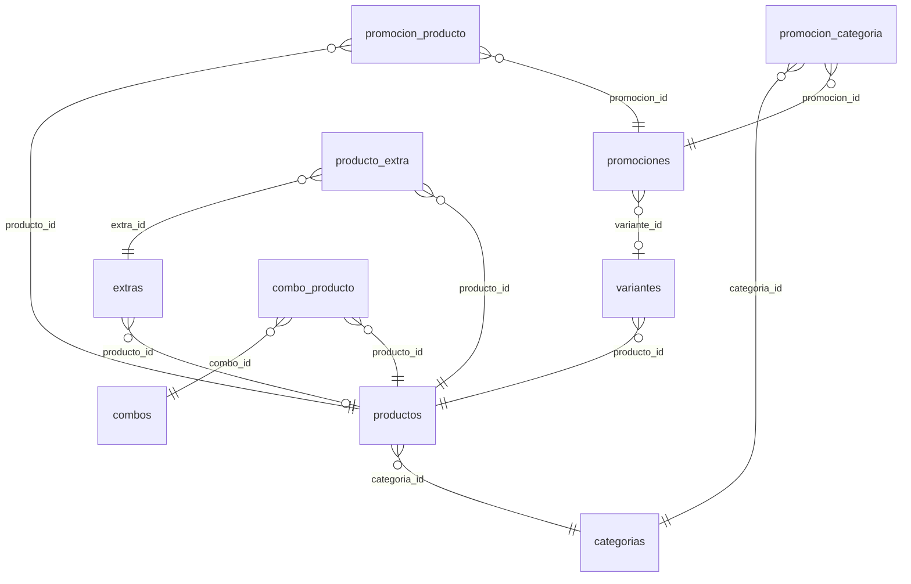
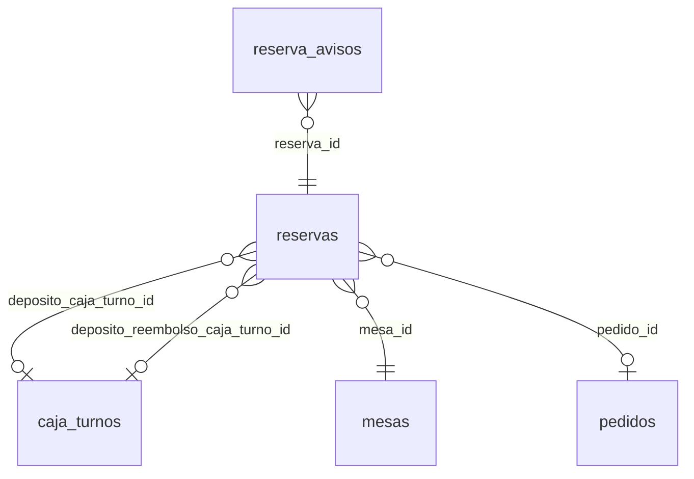
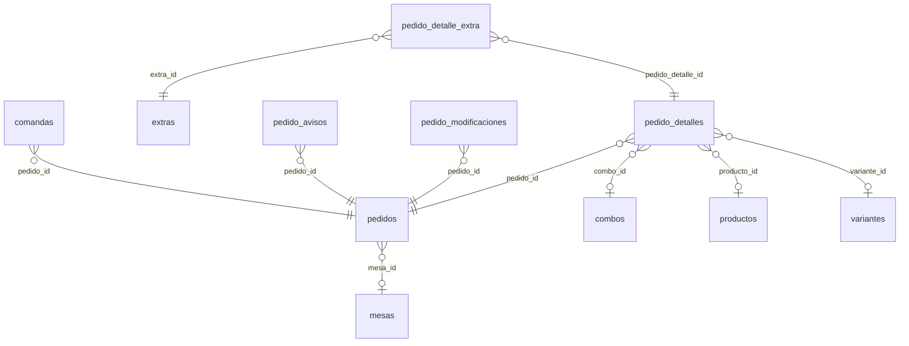
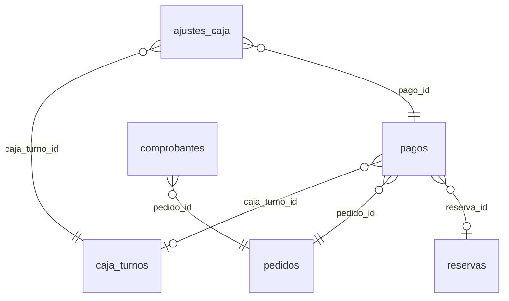
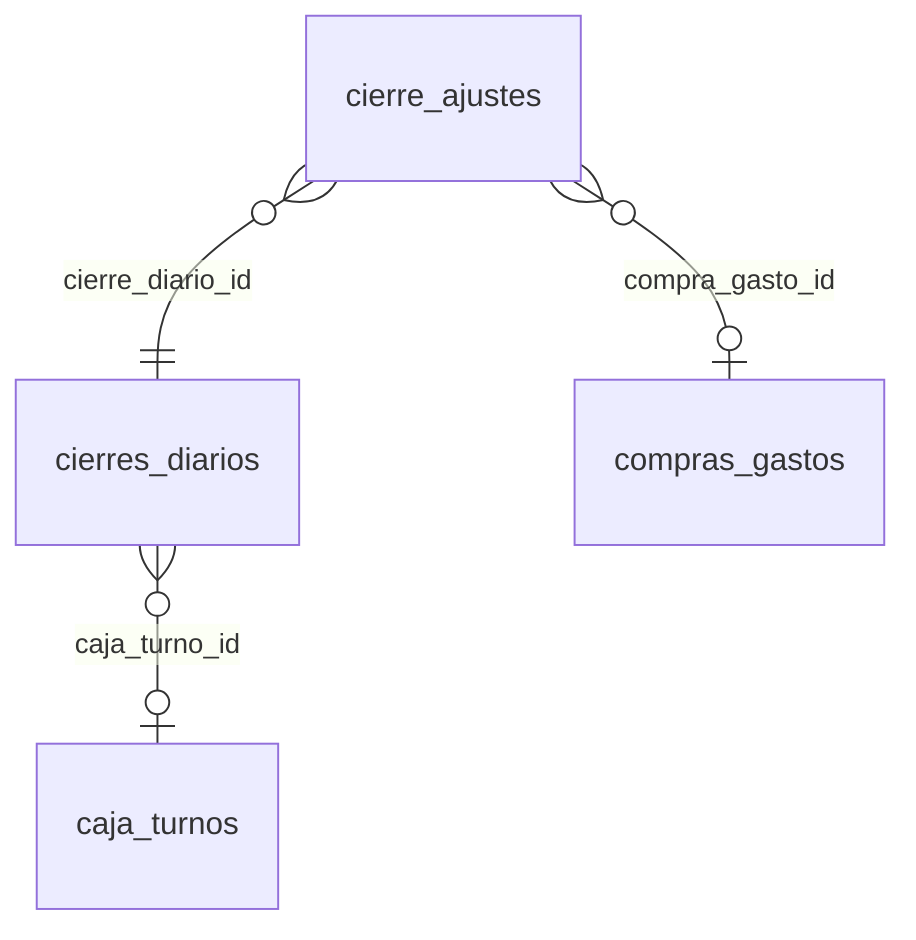

# Base de datos — Fragua Real Burger

PostgreSQL en producción; SQLite en memoria para las pruebas automáticas. 41 tablas propias del sistema más la de control de migraciones, creadas por 68 migraciones de Laravel en `backend/database/migrations`. Este documento describe cómo está hoy la base; la lógica que la usa está en [`README-BACKEND.md`](README-BACKEND.md) y los endpoints en [`API.md`](API.md).

## Contenido

- [Cómo se crea](#cómo-se-crea)
- [Tablas por módulo](#tablas-por-módulo)
- [Relaciones](#relaciones)
- [Migraciones](#migraciones)
- [Decisiones de diseño (ADR)](#decisiones-de-diseño-adr)
- [Reglas que se cumplen en el código](#reglas-que-se-cumplen-en-el-código)
- [Datos de prueba y copias de seguridad](#datos-de-prueba-y-copias-de-seguridad)

## Cómo se crea

```bash
cd backend
php artisan migrate          # crea o actualiza las tablas
php artisan db:seed          # datos de prueba (cuentas, menú, mesas)
```

Todas las migraciones posteriores a la base son **aditivas**: agregan tablas, columnas con valor por defecto o índices, y ninguna borra datos. En el servidor se corren con `php artisan migrate --force` después de cada despliegue.

La fecha del nombre de cada migración solo fija el orden en que corren; no es la fecha en que se hizo el trabajo (por ejemplo, la Fase 0 se hizo el 09/10/2026 con migraciones `2026_10_13_*`).

## Tablas por módulo

### Usuarios y seguridad (M01, M00)

| Tabla | Columnas | Qué guarda |
|---|---|---|
| `users` | 15 | Cuentas de los roles (`role`: superadmin, administrador, soporte, mesero, cliente; superadmin desde el 19/10/2026, M09, y soporte desde el 20/10/2026, M10), `menus_permitidos` (json, los menús que el SuperAdmin le habilitó; vacío = todos los de su rol), con `username` opcional y único y el permiso `puede_registrar_gastos` del Mesero autorizado. Eliminar (24/10/2026): `eliminado_at`, `eliminado_por` y `eliminado_motivo` (archivado: fuera de las listas, se restaura). |
| `personal_access_tokens` | 12 | Sesiones (tokens de Sanctum) con IP y dispositivo; vencen por inactividad o duración máxima. |
| `password_reset_tokens` | 3 | Enlaces de recuperación de contraseña (guardados con hash, vencen a la hora). |
| `auditorias` | 9 | Historial de acciones críticas: quién, qué, sobre qué registro, antes y después, IP y navegador. Triggers de PostgreSQL impiden cambiarlo o borrarlo. |

### Catálogo (M04)

| Tabla | Columnas | Qué guarda |
|---|---|---|
| `categorias` | 6 | Categorías del menú. Desactivar una oculta sus productos y combos. `permite_quitar_ingredientes` (26/10/2026): si el menú pregunta qué ingrediente quitar (las bebidas no). |
| `productos` | 15 | Productos con precio base, tipo de venta (bebida, alimento u otro), disponibilidad y foto (`imagen_path`, archivo privado). `imagen_url` es una columna antigua que ya no se usa. Eliminar (24/10/2026): `eliminado_at`, `eliminado_por` y `eliminado_motivo` (archivado: fuera de las listas, se restaura). |
| `variantes` | 8 | Presentaciones o tamaños de un producto, con su precio, su disponibilidad y, desde el 16/10/2026, una descripción y una foto propias. |
| `extras` | 8 | Adicionales: generales (`producto_id` nulo) o específicos de un producto. |
| `producto_extra` | 5 | Qué extras generales ofrece cada producto. Un extra general sin productos elegidos no se ofrece con ninguno (desde el 16/10/2026). |
| `combos` | 12 | Combos con precio propio, tipo de venta, vigencia, franja horaria y días. |
| `combo_producto` | 4 | Productos y cantidades de cada combo (al menos dos unidades). |
| `promociones` | 14 | Promociones automáticas o manuales: alcance (producto, categoría o total), porcentaje o valor, vigencia, franja y días. `variante_id` la limita a una presentación y `es_oferta` marca las creadas con «Poner en oferta». |
| `promocion_producto` | 3 | Productos de una promoción. |
| `promocion_categoria` | 3 | Categorías de una promoción. |

### Mesas y reservas (M05)

| Tabla | Columnas | Qué guarda |
|---|---|---|
| `mesas` | 11 | Mesas del local con su QR y su estado (libre, ocupada o reservada). `ocupada_desde` marca el inicio de la visita. Eliminar (24/10/2026): `eliminado_at`, `eliminado_por` y `eliminado_motivo` (archivado: fuera de las listas, se restaura). |
| `reservas` | 35 | Reservas con el depósito: método, estado, en qué turno de caja se recibió o devolvió, abono al pedido, no-show y enlace secreto para el cliente. `descripcion` es la nota opcional del cliente (hasta 500 caracteres). Pago directo: captura del depósito (`deposito_comprobante_path` y `_mime`, en `storage/app/private/comprobantes-pago`), `deposito_referencia` y `deposito_rechazo_motivo`; `deposito_pasarela` acepta `breb`. |
| `reserva_avisos` | 11 | Cada correo de una reserva (confirmación, recordatorio, cancelación, no-show): destino, estado, intentos y error. |

### Pedidos (M02, M07)

| Tabla | Columnas | Qué guarda |
|---|---|---|
| `pedidos` | 47 | Tabla única para Local, QR, Domicilio y Recogida (ADR-001): estado, totales, descuentos, datos de entrega, quién y cuándo en cada paso, y el enlace secreto del invitado. 26/10/2026: `cuenta` (cuentas separadas de la mesa), `ubicacion_lat`/`ubicacion_lng` (la ubicación que compartió el Cliente) y `paga_con` (billete del domicilio contra entrega). |
| `pedido_detalles` | 12 | Líneas del pedido: producto, presentación o combo, cantidad, precio congelado (ADR-002), su parte del descuento y si ya se preparó. |
| `pedido_detalle_extra` | 4 | Extras de cada línea con su precio congelado. |
| `pedido_modificaciones` | 14 | Historial de cambios a las líneas de un pedido ya enviado: quién, antes, después y el total. No se edita ni se borra. |
| `pedido_avisos` | 11 | Cada aviso al cliente de un pedido («listo para recoger», comprobante por correo). |
| `comandas` | 15 | Lo que se manda a la cocina (inicial, cambios o cancelación), sin precios, con su estado de impresión y una clave única para no duplicarla. |

### Caja y pagos (M06)

| Tabla | Columnas | Qué guarda |
|---|---|---|
| `caja_turnos` | 14 | Un turno de caja por día: base, efectivo esperado y contado, diferencia y quién abrió y cerró. |
| `pagos` | 23 | Pagos de un pedido (1:N, admite pago mixto, ADR-003) y abonos de depósito; anulación, reverso y cómo se aprobó (pasarela o manual). Pago directo: la captura que subió el Cliente (`comprobante_path` y `comprobante_mime`), `referencia_cliente` y `rechazo_motivo`; `pasarela` acepta `breb`. |
| `ajustes_caja` | 10 | Anulaciones o reembolsos hechos cuando la caja de ese día ya cerró (ADR-008). No reescriben el turno. |
| `comprobantes` | 12 | Comprobantes de pago con consecutivo (FR-000001), copia del documento, impresiones y anulación con motivo. |
| `transacciones_pasarela` | 28 | Cada intento de pago en Wompi (de un pago o de un depósito): referencia secreta, estado, respuesta completa, eventos, revisión y reembolso. |

### Compras, gastos y cierre (M03)

| Tabla | Columnas | Qué guarda |
|---|---|---|
| `compras_gastos` | 25 | Compras y gastos con categoría, cantidad, forma de pago, soporte privado y quién lo registró, corrigió o anuló. |
| `cierres_diarios` | 12 | Cierre del día con totales, desglose guardado, turno de caja e impresiones. |
| `cierre_ajustes` | 11 | Correcciones posteriores a un cierre, autorizadas con contraseña y motivo; el cierre original no cambia. |

### Reportes y configuración (M08)

| Tabla | Columnas | Qué guarda |
|---|---|---|
| `reporte_exportaciones` | 14 | Reportes exportados (PDF o Excel) guardados para volver a descargarlos tal cual. |
| `configuraciones` | 6 | Valores que edita el Administrador: valor del domicilio, depósito de reserva, tiempos de las reservas y datos del negocio (`negocio_direccion`, `negocio_telefono`, `negocio_logo_path` y, del SuperAdmin, `negocio_nombre`, `negocio_nit`, `negocio_latitud` y `negocio_longitud` (el punto del local en el mapa); la ruta del logo en `storage/app/private/negocio`). Del SuperAdmin también las cuentas para pagos en línea sin Wompi: `pago_nequi_*`, `pago_bancolombia_*` y `pago_breb_*`. M12: el formato del ticket (`impresion_*`). |

### Notificaciones (M11)

| Tabla | Columnas | Qué guarda |
|---|---|---|
| `notificaciones` | 10 | La campana del personal: una fila por persona que debe enterarse (`user_id`), con `tipo`, `categoria` (pedidos, reservas, caja, operacion o sistema), `titulo`, `texto`, `enlace` a la pantalla del panel, `leida_at` y `created_at`. `clave` es única por persona (`user_id` + `clave`) para que el mismo aviso no se repita. Se borran solas a los 30 días (`notificaciones:limpiar`). |

### Impresoras (M12)

| Tabla | Columnas | Qué guarda |
|---|---|---|
| `equipos_impresion` | 17 | Los equipos del local que imprimen (24/10/2026): `nombre`, `clave` única que identifica al navegador (no viaja en el JSON), `codigo_vinculacion` de 6 números con su vencimiento, qué imprime (`imprime_comandas`, `imprime_comprobantes`), `al_confirmar`, `automatico`, última señal (`ultima_senal_at`, `ultima_senal_por`) y última prueba (`ultima_prueba_at`, `ultima_prueba_resultado`: ok, fallo o cortado, `ultima_prueba_por`) y `registrado_por`. |

### Tablas de Laravel

`jobs`, `job_batches` y `failed_jobs` (cola de trabajos: correos y latido), `cache` y `cache_locks` (caché y límites de intentos), `sessions` (sesiones web de Laravel; la aplicación no la usa porque se autentica con tokens) y `migrations` (control de migraciones). Las crea la migración `2026_10_18_000001`.

## Relaciones

Cada diagrama muestra las tablas de un módulo y las llaves foráneas que salen de ellas (generado desde el esquema real). Las referencias a `users` que solo dicen quién hizo una acción (`*_por`, `user_id`) se omiten para que el diagrama se lea; están en las tablas de arriba. El diagrama completo, con las 41 tablas y todas sus columnas, tipos, llaves y valores permitidos, está en la carpeta «Documentacion Fragua Real» como `er_diagram.png` y `er_diagram.pdf` (el PDF se puede ampliar sin perder nitidez).

`}o--||` = muchas a una obligatoria; `}o--o|` = muchas a una opcional (la columna puede quedar vacía).

### Catálogo (M04)



### Mesas y reservas (M05)



### Pedidos (M02, M07)



### Caja y pagos (M06)



### Compras, gastos y cierre (M03)



Además, `transacciones_pasarela` se enlaza con un pago o con una reserva por `pagable_type` y `pagable_id` (relación polimórfica, sin llave foránea), y `personal_access_tokens` con su usuario por `tokenable_type` y `tokenable_id`.

## Migraciones

| Migración | Etapa | Qué hace | Punto en README-BACKEND |
|---|---|---|---|
| `2026_01_01_000001 a 000022` | Base | Tablas originales: users → categorias → mesas → productos → variantes → extras → combos → combo_producto → promociones → promocion_producto → promocion_categoria → reservas → caja_turnos → pedidos → pedido_detalles → pedido_detalle_extra → pagos → comprobantes → compras_gastos → cierres_diarios → auditorias → password_reset_tokens. | — |
| `2026_09_25_015424` | Base | `personal_access_tokens` (Sanctum). | — |
| `2026_09_28_000001` | Base | `configuraciones` (domicilio y depósito editables). | — |
| `2026_09_29_000001` | Base | `pedido_detalles.producto_id` acepta nulo (líneas de combo). Funciona en PostgreSQL y SQLite. | — |
| `2026_10_13_000001` | Fase 0 | Entrega y recogida confirmadas en `pedidos` (`entregado_*`, `recogido_*`). | 15 |
| `2026_10_13_000002` | Fase 0 | Tabla `ajustes_caja` y tipo de reverso en `pagos`. | 15 |
| `2026_10_13_000003` | Fase 0 | `pedidos.token_publico` (enlace del invitado). | 15 |
| `2026_10_13_000004` | Fase 0 | IP y navegador en `auditorias`. | 15 |
| `2026_10_14_000001` | Fase 1 | Tabla `pedido_modificaciones`. | 16 |
| `2026_10_14_000002` | Fase 1 | `telefono_contacto` y `observaciones_entrega` en `pedidos`. | 17 |
| `2026_10_14_000003` | Fase 1 | Método y pasarela de pago elegidos en `pedidos`. | 17 |
| `2026_10_14_000004` | Fase 1 | `mesas.ocupada_desde`. | 18 |
| `2026_10_14_000005` | Fase 1 | `reservas.creado_por` acepta administrador; `reservas.registrada_por`. | 19 |
| `2026_10_14_000006` | Fase 1 | `variantes.disponible`. | 20 |
| `2026_10_15_000001` | Fase 2 | Descuentos y promociones en `pedidos` y `pedido_detalles`. | 22 |
| `2026_10_15_000002` | Fase 2 | Abono del depósito: `pagos.tipo` y `reserva_id`; en `reservas`, pedido abonado, llegada y turnos del depósito. | 23 |
| `2026_10_16_000001` | Fase 2 | Tabla `producto_extra`. | 24 |
| `2026_10_16_000002` | Fase 2 | Completa `compras_gastos` (cantidad, unidad, soporte privado, trazabilidad). | 25 |
| `2026_10_16_000003` | Fase 2 | Desglose y turno en `cierres_diarios`; tabla `cierre_ajustes`. | 26 |
| `2026_10_17_000001` | Fase 3 | Triggers que protegen `auditorias` e índice por fecha. | 27 |
| `2026_10_17_000002` | Fase 3 | `users.username`. | 29 |
| `2026_10_17_000003` | Fase 3 | IP y navegador en `personal_access_tokens`. | 30 |
| `2026_10_18_000001` | Fase 4 | Tablas de Laravel para cola, caché y sesiones, si no existen. | 31 |
| `2026_10_18_000002` | Fase 4 | No-show automático y recordatorio en `reservas`. | 33 |
| `2026_10_18_000003` | Fase 4 | `reservas.token_publico` y tabla `reserva_avisos`. | 34 |
| `2026_10_18_000004` | Fase 4 | «Listo para recoger» y correo del invitado en `pedidos`; tabla `pedido_avisos`. | 35 |
| `2026_10_19_000001` | Fase 5 | Completa `comprobantes` (consecutivo, detalle, anulación). | 36 |
| `2026_10_19_000002` | Fase 5 | `comprobantes.impresiones`. | 37 |
| `2026_10_19_000003` | Fase 5 | `cierres_diarios.impresiones`. | 38 |
| `2026_10_19_000004` | Fase 5 | Tabla `reporte_exportaciones`. | 39 |
| `2026_10_20_000001` | Fase 6 | Tabla `transacciones_pasarela`; cómo y quién aprobó en `pagos`; `reservas.deposito_confirmado_via`. | 41 |
| `2026_10_20_000002` | Fase 6 | Tabla `comandas`. | 42 |
| `2026_10_21_000001` | Fase 7 | `users.puede_registrar_gastos`. | 47 |
| `2026_10_21_000002` | Fase 7 | `productos.imagen_path`. | 48 |
| `2026_10_22_000001` | Fase 7 | Solo índices para reportes y búsquedas frecuentes. | 50 |
| `2026_10_23_000001` | 16/10/2026 | Asocia los extras generales sin productos a los de tipo Alimento (desde aquí un general solo se ofrece donde se asocia). | — |
| `2026_10_23_000002` | 16/10/2026 | `variantes.descripcion`, `imagen_url` e `imagen_path`. | — |
| `2026_10_23_000003` | 16/10/2026 | `promociones.variante_id` y `promociones.es_oferta`. | — |
| `2026_10_26_000001` | 19/10/2026 | `reservas.descripcion`: nota opcional del cliente en su reserva. | — |
| `2026_11_02_000001` | 26/10/2026 | Mejoras de operación: `pedidos.cuenta`, `ubicacion_lat`, `ubicacion_lng`, `paga_con` y `categorias.permite_quitar_ingredientes` (las categorías de bebidas quedan en falso). | — |
| `2026_11_01_000001` | 24/10/2026 | Tabla `equipos_impresion` (M12): equipos del local que imprimen, con su clave, código de vinculación, señal y última prueba. | — |
| `2026_10_31_000001` | 24/10/2026 | Eliminar: `eliminado_at` (con índice), `eliminado_por` (→ `users`, nulo al borrarse) y `eliminado_motivo` en `mesas`, `productos` y `users`. | — |
| `2026_10_30_000001` | 22/10/2026 | Pago directo: captura, referencia y motivo del rechazo en `pagos` y `reservas`; `pasarela` y `deposito_pasarela` aceptan `breb` (en PostgreSQL cambian `pagos_pasarela_check` y `reservas_deposito_pasarela_check`). Al deshacerla, un `breb` queda en nulo. | — |
| `2026_10_29_000001` | 21/10/2026 | Tabla `notificaciones` (M11): la campana del personal, con índice único `user_id` + `clave` y los índices para contar las no leídas y limpiar las viejas. | — |
| `2026_10_28_000001` | 20/10/2026 | `users.role` acepta `soporte` (M10). En PostgreSQL cambia la restricción `users_role_check`; al deshacerla, una cuenta de Soporte queda como Cliente desactivada y sin sesiones (nunca como Administrador). | — |
| `2026_10_27_000001` | 20/10/2026 | `users.menus_permitidos`: permisos de menú por cuenta (M09). | — |
| `2026_10_26_000002` | 20/10/2026 | `users.role` acepta `superadmin` (M09). En PostgreSQL cambia la restricción `users_role_check`; al deshacerla, un SuperAdmin vuelve a Administrador. | — |
## Decisiones de diseño (ADR)

### ADR-001 — Una sola tabla `pedidos` para Local, QR, Domicilio y Recogida

M02 y M07 comparten los estados (PENDIENTE → CONFIRMADO → PREPARANDO → FINALIZADO o CANCELADO), la
comanda y el cobro. En vez de dos tablas, `pedidos.tipo` distingue el canal (`local`, `domicilio`,
`recogida`) y `pedidos.origen` quién lo creó (`mesero`, `qr`, `cliente_web`). Las columnas de un canal
quedan en `NULL` en los demás:

- `mesa_id` → solo `local`;
- `direccion_entrega`, `barrio`, `referencia`, `valor_domicilio` → solo `domicilio`;
- `cliente_invitado_*` y `token_publico` → domicilio o recogida sin cuenta.

### ADR-002 — Precio congelado en cada línea

`pedido_detalles.precio_unitario_congelado` y `pedido_detalle_extra.precio_congelado` copian el precio
vigente al crear la línea. Cambiar un precio en el Catálogo no altera los pedidos ya hechos (M02, M04 y
M07). Lo mismo pasa con `pedidos.valor_domicilio` y `reservas.deposito_valor`: guardan el valor de
`configuraciones` del momento.

### ADR-003 — Pagos como tabla 1:N

Un pedido se puede pagar con varios métodos (RN-M06-04, pago mixto), así que `pagos` es una tabla
aparte. La suma de los pagos no anulados nunca supera `pedidos.total` (RF-M06-011). El abono del
depósito de una reserva es un pago de tipo `deposito`, sin turno de caja, porque ese dinero entró el
día en que se pagó el depósito.

### ADR-004 — El Mesero es quien cobra

Los cobros presenciales (local, domicilio contra entrega y recogida) los registra siempre el Mesero
(RF-M06-003/004, RNF-M06-004). El Administrador abre y cierra la caja y autoriza anulaciones, pero no
cobra. En un pago en línea, `pagos.registrado_por` queda en `NULL` y `confirmado_via` dice si lo aprobó
la pasarela o una persona.

### ADR-005 — Extras generales y específicos

Un extra `especifico` siempre tiene `producto_id`. Uno `general` tiene `producto_id` nulo y la tabla
`producto_extra` dice qué productos lo ofrecen; sin productos elegidos no se ofrece con ninguno
(RF-M04-011, CA-M04-004; hasta el 16/10/2026 se ofrecía con todo el menú, ver la migración
`2026_10_23_000001`). Antes de la Fase 2 no existía `producto_extra` y los generales no salían en
ningún canal.

### ADR-006 — Reportes sin tablas propias

M08 es de solo lectura (RN-M08-01): sus 6 reportes se calculan con consultas sobre `pedidos`,
`pedido_detalles`, `pagos`, `compras_gastos`, `cierres_diarios` y `reservas`. El resultado operativo
usa los cierres diarios ya guardados y solo calcula en vivo los días sin cierre. No hay caché: cada
reporte se recalcula siempre, para que nunca muestre cifras viejas (RNF-M08-001/002). La única tabla de
M08 es `reporte_exportaciones`, el archivo de los documentos ya exportados.

### ADR-007 — Cuándo un pedido queda FINALIZADO

Solo desde PREPARANDO, con el pago completo y, en domicilio y recogida, con la entrega o la recogida
confirmada (RN-PED-32, RN-M07-06, RN-M07-R-04). Un pago en línea aprobado no finaliza el pedido.

### ADR-008 — Ajustes cuando la caja ya cerró

Anular o reembolsar un pago de un día con la caja cerrada pide la contraseña del Administrador y queda
en `ajustes_caja`, sin reescribir el turno (RF-M06-019). Igual con las compras y gastos de un día ya
cerrado: quedan en `cierre_ajustes` y el cierre original no cambia.

### ADR-009 — Enlaces secretos para quien no tiene cuenta

El invitado ve, paga y cancela su pedido con `pedidos.token_publico`, y cualquier cliente ve y cancela
su reserva con `reservas.token_publico`. Los tokens solo se entregan al crear el registro y no salen en
las demás respuestas.

### ADR-010 — Historial que no se puede cambiar

`auditorias` y `pedido_modificaciones` solo reciben inserciones. En `auditorias`, triggers de PostgreSQL
rechazan UPDATE, DELETE y TRUNCATE (RNF-TRANS-022). Por eso un usuario con historial no se borra: se
desactiva.

### ADR-011 — Índices para las llaves foráneas

PostgreSQL no crea índices para las llaves foráneas. La migración `2026_10_22_000001` los agrega donde
se lee mucho: pedidos por estado y fecha, líneas y extras de cada pedido, pagos, reservas y ajustes de
caja. Con un año de historia de prueba, un reporte de un mes pasó de más de 2 minutos a menos de medio
segundo (README-BACKEND, punto 50).

## Reglas que se cumplen en el código

Estas reglas no se pueden expresar solo con columnas; las aplica Laravel:

| Regla | Dónde |
|---|---|
| Solo el Mesero registra cobros presenciales (RF-M06-003/004) | `PedidoPolicy::cobrar()`, `PagoService::validarQuienCobra()` |
| Los pagos no superan el total del pedido (RF-M06-011) | `PagoService` |
| Un turno de caja por día (RN-M06-03) | `caja_turnos.fecha` única y `CajaService` |
| Sin caja abierta no hay cobros ni depósitos presenciales (RN-M06-02) | `PagoService`, `ReservaService` |
| Un combo no se ofrece si un componente está agotado o de baja (RN-M04-11) | `Combo::disponible()`, `ComboService::disponibleParaPedido()` |
| Un producto con presentaciones se pide con una de ellas (RN-M04-04) | `Producto::puedeAgregarseAPedido()`, `PedidoService` |
| El valor del domicilio y el depósito se copian del valor vigente | `PedidoController::store()` y `ReservaController::store()`, con `Configuracion::obtenerNumerico()` |
| Un pedido confirmado solo cambia en líneas no preparadas (RN-PED-08/10) | `PedidoService` |
| La mesa se ocupa con el primer pedido y se libera sin pedidos activos (RN-M05-04/05) | `PedidoService`, `MesaController` |

## Datos de prueba y copias de seguridad

- `php artisan db:seed` crea las cuentas de prueba (admin, mesero y cliente con contraseña
  `password`), el menú de ejemplo con presentaciones, extras y un combo, las mesas y los valores de
  `configuraciones`. Antes de usar el sistema con datos reales hay que cambiar esas contraseñas o
  desactivar las cuentas.
- Además de la base, las copias de seguridad deben incluir `backend/storage/app/private`: soportes de
  compras y gastos, fotos de productos (`productos/`), reportes exportados (`reportes/`) y capturas de
  los pagos por transferencia (`comprobantes-pago/`).
